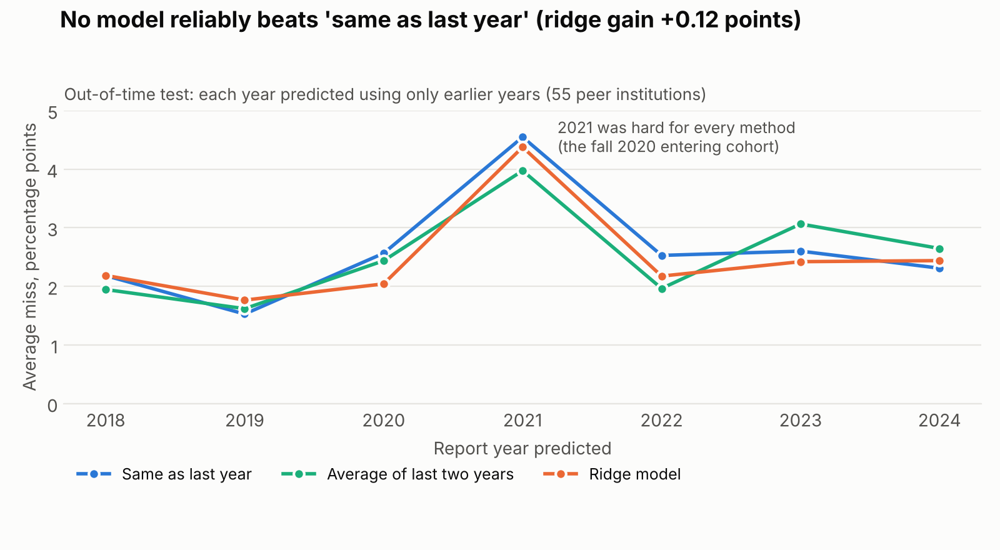
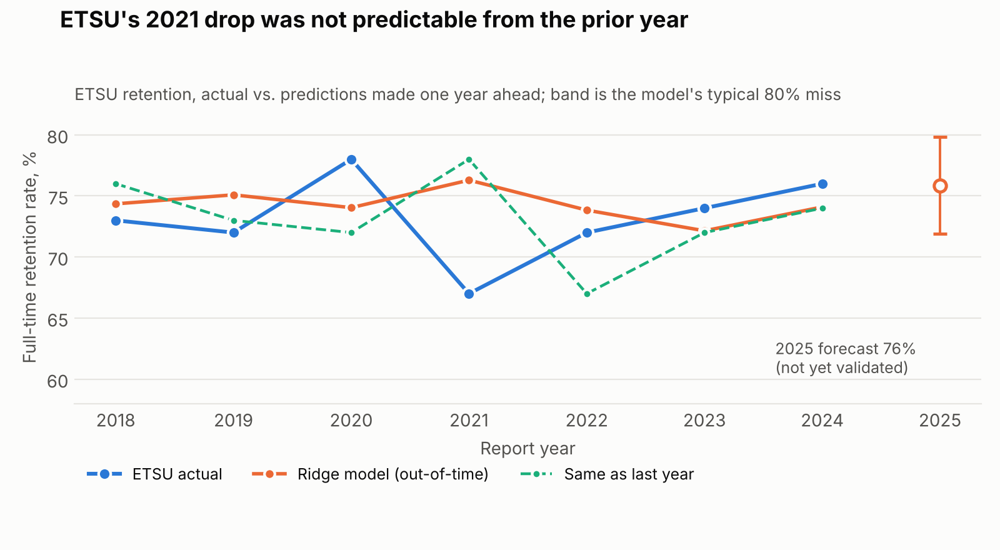

# Retention and graduation outcomes at ETSU vs. public peer institutions

How does East Tennessee State University's first-year retention and six-year graduation
rate compare with public peer institutions, how has the gap changed since 2013, and how
well can next year's retention be predicted from what is already known?

All data is public and aggregate (federal IPEDS files, report years 2013 to 2024). Stack:
SQL (SQLite), Python (pandas, scikit-learn), and Power BI tables with DAX measures.



## What the data shows

- **Retention.** ETSU's full-time retention rate rose from 66% (2013) to
  76% (2024). The median of the 39 regional peers was
  78% in 2013 and 78% in 2024, so the
  gap narrowed from 12 to
  2 points. ETSU moved from above
  5% of regional peers to above
  23%. Against the Georgia group (median
  77% in 2024) ETSU was 1 point(s) lower.
- **Six-year graduation.** ETSU went from 41.3% to 53.2%, while the
  regional median went from 51.2% to 57.7%
  (gap 9.9 to 4.5
  points). Compared with the Georgia group median (48.9%), ETSU was
  4.3 points higher.
- **These are unweighted medians across a mixed pool** (flagships, regional universities,
  historically Black institutions). They describe position, not cause.

## Peer rule

Public, four-year, active institutions that offer undergraduate degrees and sit in
Carnegie 2021 Basic classes 15 to 19 (doctoral and master's universities). The rule is
applied in SQL (`sql/01_views.sql`), not by hand-picking schools.

| Group | States | Institutions |
|---|---|---|
| Regional (home: ETSU) | TN, NC, VA, KY | 40 |
| Georgia | GA | 15 |

Carnegie class is kept as a column so results can be read within class. Institutions
that merged under a new ID keep only the years filed under the current ID.

## Data validation

16 SQL checks run on every build (8 pass, the rest are flags with a handling
decision each). Full log: `docs/data_quality_log.md`. Findings worth knowing:

- IPEDS ships original and revised files; they disagree for some institutions. The
  pipeline uses the revised value and logs every difference.
- The graduation cohort year was **tested, not assumed**: entering-class counts match
  graduation cohorts six years later with a 0.1% median difference (4, 5, 7 and 8 year
  offsets were 5% or worse).
- Two institutions (Albany State, Georgia Southern) show entering-class and graduation-cohort
  counts more than 10% apart in 9
  institution-years; both appear on the University System of Georgia's list of consolidated
  campuses. The graduation rate uses the bachelor's subcohort, so the rate does not depend on those counts.
- Imputed values exist in the national file but none fall inside the peer set (all 658
  peer observations are flagged "reported").

## Model

Task: predict an institution's next-year retention from information known one year earlier
(prior two years of retention, prior graduation rate, student-faculty ratio, cohort size,
Carnegie class, group). Evaluation is out-of-time: for each report year from 2018 to 2024
the models are trained only on earlier years (385 test predictions in total).

| Model | Average miss (percentage points) |
|---|---|
| Same as last year | 2.61 |
| Average of last two years | 2.52 |
| Ridge regression | 2.49 |
| Gradient boosting | 2.65 |

**Result: retention is mostly persistent, and no model reliably beats "same as last year."**
Ridge's average gain over that baseline is 0.12 points, but the 95% interval
(-0.02 to +0.26, resampling institutions) includes zero, so the
gain cannot be told apart from noise. An earlier build that ended at report year 2023 showed a
small positive gain; adding 2024 removed it. Gradient boosting is no better (-0.05).
Every method missed badly in 2021, the fall 2020 entering cohort. ETSU's own 2021 drop
(78% to 67%) was not predicted by any model. In 2024, Tennessee State fell from 60% to 33%
(reported as such, and consistent with its retained and cohort counts); the ridge model missed
that one value by 31 points. Removing it barely changes the comparison
(+0.11, interval -0.04 to +0.26).



**Forecast check.** Before the 2024 files were loaded, the model forecast ETSU's 2024
retention at 74% (80% band about 4 points; saved in
`docs/forecast_2024_made_before_data.json`). ETSU reported 76%: inside the band, 2 points
below the actual value, and no better than "same as last year" (74%). A forecast for report year 2025 is in
`outputs/etsu_forecast_2025.json` (76%); it is unvalidated until the 2025 files are published.

## Governance

Aggregate institution-level public data only; no student records. Rates whose cohort is
under 30 students are suppressed together with the counts behind them (none trigger
today). Data lineage, definitions and flag meanings: `docs/data_dictionary.md` and
`docs/governance.md`. This shows how a small-cell rule and lineage notes are applied; it is
not experience handling restricted student data.

## Limitations

- Retention covers first-time, full-time students only; part-time and transfer students are outside it.
- Peer medians are unweighted and the pool is heterogeneous.
- Features for year t-1 are published during year t, so this is a one-step-ahead
  benchmark, not an operational early-warning tool.
- Institution-level model with no admissions, aid or demographic inputs.
- Mergers that changed an institution's ID were not stitched into one series.
- Report year 2024 is included. Report year 2025 (fall 2025 enrollment) is not published yet.
  The 2024 files were downloaded by hand from the IPEDS Complete Data Files page and are
  provisional; no revised 2024 file exists yet, so values may change when one is released.
- The peer list comes from the 2023 directory file; institutions that closed or changed
  classification in 2024 were not re-checked.
- The Power BI file is built from `outputs/powerbi/` using `docs/powerbi_build_guide.md`.
  The DAX there was written outside Power BI Desktop and must be tested in it.

## Run it

```bash
bash src/00_download.sh            # downloads 2013-2023 (2024 files: see note in that script)
pip install pandas scikit-learn matplotlib tabulate openpyxl
bash run_all.sh                    # build db, checks, log, model, export, figures, README
```

| Script | Purpose |
|---|---|
| `src/01_build_db.py`, `sql/01_views.sql` | Load files, define peer rule and views |
| `sql/02_quality_checks.sql`, `src/02_quality_checks.py` | Sixteen validation queries |
| `src/03_dq_log.py` | Generate the data-quality log |
| `src/04_model.py` | Out-of-time model evaluation |
| `src/05_export_dashboard.py` | Power BI tables, findings summary |
| `src/06_charts.py`, `src/07_build_readme.py` | Figures and this README |

Source: National Center for Education Statistics, IPEDS Data Center.
