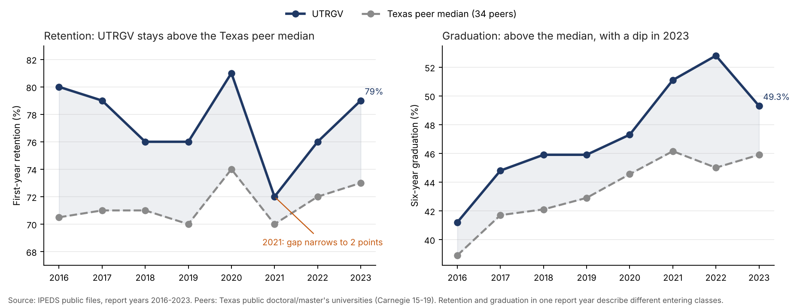

# UTRGV retention and graduation vs. Texas public peer universities

**The question.** How do the University of Texas Rio Grande Valley's first-year retention and six-year graduation rates compare with similar Texas public universities, and how has that changed since UTRGV opened?

**Data.** Public, school-level numbers that every U.S. college reports to the federal government (IPEDS), report years 2013 to 2023. No student records. **Tools:** SQL (SQLite) and Python (pandas). This reuses the method from the ETSU analysis in the folder above: a documented peer rule in SQL, a revised-file-wins rule, and 16 data-quality checks.

*Retention rate: the share of first-time, full-time students who come back the next fall. Graduation rate: the share who finish a bachelor's degree within six years.*



## The short answer

1. **Retention is above the Texas peer median in every year since UTRGV opened.** The gap ranged from 2 to 9.5 points. In 2023 UTRGV was at 79% and the median was 73%.
2. **The narrowest point was 2021.** UTRGV fell 9 points to 72%, and the gap shrank to 2 points. It recovered to 79% by 2023. The largest year-over-year moves among Texas peers also cluster in 2021, in both directions (4 of 13 flagged jumps, from -24 to +17 points).
3. **Six-year graduation is also above the median, but it fell in 2023.** It rose from 41.2% to a peak of 52.8% in 2022, then dropped 3.5 points to 49.3%. That is the class that entered in 2017.

## What the data shows

UTRGV's first entering class was fall 2015, so report year 2016 is the first year that describes UTRGV. Earlier years are filed under the same IPEDS ID but cover the period before UTRGV opened, so they are left out of the findings (they remain in the CSVs).

| Report year | UTRGV retention | Texas peer median | Gap (pts) | UTRGV 6-yr graduation | Texas peer median | Gap (pts) |
|---|---|---|---|---|---|---|
| 2016 | 80% | 70.5% | +9.5 | 41.2% | 38.9% | +2.3 |
| 2017 | 79% | 71.0% | +8.0 | 44.8% | 41.7% | +3.1 |
| 2018 | 76% | 71.0% | +5.0 | 45.9% | 42.1% | +3.8 |
| 2019 | 76% | 70.0% | +6.0 | 45.9% | 42.9% | +3.0 |
| 2020 | 81% | 74.0% | +7.0 | 47.3% | 44.6% | +2.8 |
| 2021 | 72% | 70.0% | +2.0 | 51.1% | 46.2% | +4.9 |
| 2022 | 76% | 72.0% | +4.0 | 52.8% | 45.0% | +7.8 |
| 2023 | 79% | 73.0% | +6.0 | 49.3% | 45.9% | +3.4 |

With research-heavy (Carnegie class 15) schools removed, the retention gap is larger: 5 to 13 points. See `outputs/utrgv_vs_tx_no_r1.csv`.

**One thing to keep in mind.** Retention and graduation in the same report year describe different entering classes. Graduation in report year 2023 describes students who entered in 2017.

## How peers were chosen

Public, four-year, active schools that offer undergraduate degrees and are classified as doctoral or master's universities (Carnegie 2021 classes 15 to 19), in Texas. That is 35 schools, so UTRGV has 34 peers. The rule runs in SQL (`sql/01_views.sql`), so I did not hand-pick schools. Medians are unweighted across a mixed pool (flagships, regional universities and others), so they show position, not cause.

## How the data was checked

16 checks run on every build (`src/02_quality_checks.py`, results in `outputs/dq/`). 7 pass and 9 are flags, covering missing values, large year-to-year moves and revised files at other Texas schools. **No flagged row involves UTRGV.**

Cross-checks against public sources:
- IPEDS shows 76% for report year 2022, which matches the UT System data book's 76% for the fall 2021 cohort.
- IPEDS shows 72% for 2021, consistent with the 72.9% UTRGV reported for 2021 (IPEDS publishes whole numbers).

## What this data cannot say

- **Why** retention or graduation changed, or **which students** are affected. Public data has no aid, major, first-generation or part-time detail.
- **Anything after report year 2023.** The 2024 IPEDS files did not resolve at the download address when this was built. UTRGV has reported 83% first-year retention for fall 2024 in the press, which is not in these files.
- **Cause.** The peers are a mixed group, and the analysis covers only first-time, full-time students.

## Run it yourself

```bash
pip install -r requirements.txt
bash run.sh        # downloads IPEDS files from nces.ed.gov, builds the database, runs the checks, writes the CSVs
```

| File | What it is |
|---|---|
| `outputs/utrgv_vs_tx_all.csv` | Yearly values, peer medians, gaps and percentiles for all Texas peers |
| `outputs/utrgv_vs_tx_no_r1.csv` | Same, without class 15 (research-heavy) schools |
| `outputs/dq/`, `outputs/dq_summary.csv` | Results of the 16 data-quality checks |
| `sql/01_views.sql` | Peer rule and analysis views |
| `outputs/figures/utrgv_vs_texas_peers.png` | The chart above (`src/04_chart.py`) |
| `src/` | Download, build, check, comparison and chart scripts |

Built from public IPEDS data. This is an independent analysis and is not affiliated with UTRGV.
